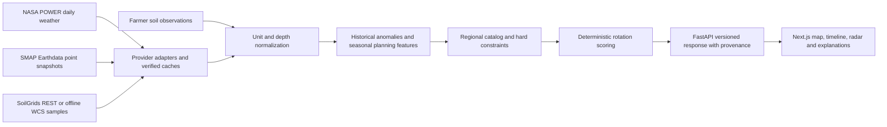

# Field Shift — architecture

Status: implementation blueprint. Scope: point-based, regional decision support for the NASA Space Apps Challenge. Baseline: 1991–2020; rules: `agronomy-v1`; contract: `1.0.0`. Phase 0 must validate upstream payloads before application code depends on them.

## Pipeline

POWER combines modeled/reanalysis and Earth-observation-derived information; do not describe every input as a direct satellite measurement. SoilGrids is a modeled soil map. SMAP is a regional surface-moisture observation, not an in-field sensor.

## Component ownership

| Component | Responsibility |
| --- | --- |
| `backend/app/api/v1/` | Validate requests, invoke service, map errors, return typed envelopes |
| `backend/app/schemas/` | Pydantic request/response and normalized provider models |
| `backend/app/providers/` | POWER, SoilGrids, SMAP snapshot adapters; no agronomic decisions |
| `backend/app/services/` | Cache policy, orchestration, deadlines, provenance, quality classification |
| `backend/app/features/` | Unit conversion, topsoil aggregation, climate anomalies, moisture quality |
| `backend/app/engine/` | Pure feasibility filters, sequence enumeration, scores, reason codes |
| `backend/app/catalog/` | Versioned regional crops, calendars, tolerances and references |
| `backend/scripts/` | Opt-in upstream probes, baseline precomputation, snapshot generation |
| `backend/tests/fixtures/` | Raw captured payloads, normalized expectations, checksummed manifests |
| `frontend/src/lib/generated/` | OpenAPI-generated types; no manual edits |
| `frontend/src/components/` | Client map/charts and accessible tables |

Start with one deployable FastAPI service and one Next.js app. A filesystem cache suffices for a single-instance demo; production uses a shared durable cache/rate limiter. Hide storage behind interfaces rather than adding infrastructure to the scoring engine.

## Data acquisition

| Source | Query and normalization | Planning limitation |
| --- | --- | --- |
| POWER | GET `https://power.larc.nasa.gov/api/temporal/daily/point`; `PRECTOTCORR,T2M`, `community=AG`, JSON, UTC, explicit inclusive dates | Grid-level historical weather; no future daily rainfall or temperature |
| SoilGrids | GET `https://rest.isric.org/soilgrids/v2.0/properties/query`; repeated properties/depths/statistics as in `.cursorrules` | REST documented as paused on verification date; soil maps at 250 m are estimates |
| SMAP | Offline extraction of `SPL3SMP_E`, Version 6; recommended-quality retrievals, fixed AM pass, nearest valid containing grid cell | 9 km posting grid, coarse radiometer footprint, approximately top 5 cm; not root-zone moisture |
| Local soil | Optional farmer-observed 0–30 cm composite, sample date and canonical units | Self-reported, not automatically certified laboratory evidence |

Verified 2026-09-26: [ISRIC access documentation](https://docs.isric.org/globaldata/soilgrids/SoilGrids_faqs_02.html) reports REST paused and a five-calls/minute fair-use limit. Ship a cached snapshot path. Produce genuine SoilGrids point snapshots from official WCS/WebDAV in a separate preprocessing environment with geospatial dependencies; preserve georeferencing and raw source values. A WCS-generated snapshot is not a captured REST response.

[NSIDC's product page](https://nsidc.org/data/spl3smp_e/versions/6) specifies Earthdata authentication and HDF5 access. Use a preprocessing tool/environment for HDF5 and projection support; the request service only needs normalized JSON. Pin collection version and granule revision. Review provider advisories before capture, including the geolocation advisory for 2026-05-14 through 2026-07-28; exclude affected unreprocessed granules. SMAP is optional until a real extraction is verified.

## Feature transformation

1. Validate provider shape, units, sentinel values, coordinates, date keys, and version. Store immutable raw data and separate normalized output.
2. Normalize soil properties independently. For complete 0–5, 5–15, and 15–30 cm layers, compute `(5*x1 + 10*x2 + 15*x3)/30`. Arithmetic depth averaging is a documented demo approximation, including pH; do not claim a mass-weighted laboratory composite. Missing any layer makes that property's aggregate null. Retain layer quantiles internally; never average quantile endpoints into a claimed aggregate prediction interval.
3. Overlay nonnull farmer values property by property at exactly 0–30 cm. Keep field-level attribution to `farmer_input` versus `soilgrids`. Local inputs supersede maps for screening but remain self-reported.
4. Compare the previous 90 inclusive days ending `assessment_end` with matching calendar days in 1991–2020. Apply the coverage and leap-day rules in `AGRONOMY_RULES.md`. Return rainfall percent anomaly and temperature °C anomaly with baseline dates and valid-year counts.
5. For each requested future slot, use that slot's seasonal baseline rainfall and temperature. Apply current anomalies only as a labeled stress scenario. Each slot is evaluated from its own dates; do not repeat the last 90-day rainfall total across future seasons.
6. Use SMAP's last 14 days only to inform near-term establishment (slot starts within 30 days of assessment); beyond that, omit its scoring contribution. Missing/old/flagged moisture is null, not dry.

## Rotation engine

Load a small versioned catalog for `punjab_pk_demo_v1`; each crop must have sourced region/calendar eligibility, maturity duration, family, nitrogen-demand class, rooting class, rainfall requirement range, seasonal temperature range, pH range, and drought/waterlogging tolerance. Crop IDs are served by a supporting `GET /api/v1/crops?region_id=...` endpoint; its contract is part of Phase 1.

Apply hard constraints before scoring. Enumerate at most `12^4=20,736` sequences; sort by unrounded score descending, then lexicographic crop-ID tuple. Return up to three feasible alternatives, total feasible count, exclusion reasons, five component scores, and reasons. Detail all weights/rules in `AGRONOMY_RULES.md`; scores remain deterministic for identical normalized inputs/catalog/rules.

## Cache and availability

- Cache key includes provider, product/version, native grid identity (where verified), normalized parameters, dates, units/time standard, and transformation version. Before grid identity is known, use exact requested coordinates. Never round farms together to invent spatial precision.
- Historical complete-year POWER/baseline and soil snapshots are release-pinned; refresh explicitly. Recent POWER responses: 24h fresh, maximum seven days since fetch for bounded stale fallback. SMAP: 24h fresh and latest valid observation no more than seven days before assessment. A fresh fetch cannot make an old observation current.
- Shared single-flight, provider rate limits, and circuit breakers prevent repeated upstream requests. Baselines are prepared in Phase 0; cold unsupported points receive 503 with a specific baseline warning/error rather than an unbounded live backfill.
- `auto` uses genuine caches/live data, never demo fixtures. `fixture` uses only exact pinned demo locations/periods and requires `ENABLE_DEMO_FIXTURES=true`. Reject unknown fixture requests with 422.
- Successful degraded responses are HTTP 200. Missing POWER/baseline is 503; optional sources reduce quality and available component weights. A valid empty candidate set is `no_feasible_rotation`, with actionable constraint reasons.
- Minimum climate prerequisite: at least one coverage-qualified observed POWER variable and at least one qualified seasonal baseline variable for every slot. If this fails, return 503 even when crop history/soil can be scored. A valid rainfall total with a too-small percent-anomaly denominator still counts as an observed variable.

## Dashboard and operations

- Map click/manual coordinates → crop history, irrigation and dated slots → POST recommendation → alternatives and reasons.
- Timeline shows requested slot dates and selected crops. Climate panels label the observed period and stress assumptions. Soil radar shows independently normalized axes with raw units, source tooltips and a table; missing axes are omitted, never zero-filled. Use sand/silt/clay/pH/SOC/total-N axes, not unmeasured phosphorus or potassium.
- Always show source modes, dates, quality limitations and an offline/demo badge. Abort outdated requests when the point changes. Keyboard coordinate entry and chart tables cover map/chart accessibility. Tile failure keeps coordinate entry usable.
- Same-origin Next.js proxy forwards to FastAPI; no provider secrets in browser bundles. Use request IDs, provider latency/cache metrics, structured logs, liveness/readiness and explicit origin/rate controls.
- Verification: unit conversion and agronomy boundary tests, HTTPX transport failure tests, OpenAPI/type drift checks, and one end-to-end offline farm-selection flow. Live verification is separate from CI.

## Primary references

- [POWER daily API and time standards](https://power.larc.nasa.gov/docs/services/api/temporal/daily/)
- [POWER parameter dictionary guidance](https://power.larc.nasa.gov/docs/tutorials/parameters/)
- [SoilGrids properties, depths and conversions](https://docs.isric.org/globaldata/soilgrids/SoilGrids_faqs_01.html)
- [SMAP Version 6 quality flags and fields](https://nsidc.org/sites/default/files/documents/user-guide/spl3smp_e-v006-userguide.pdf)
